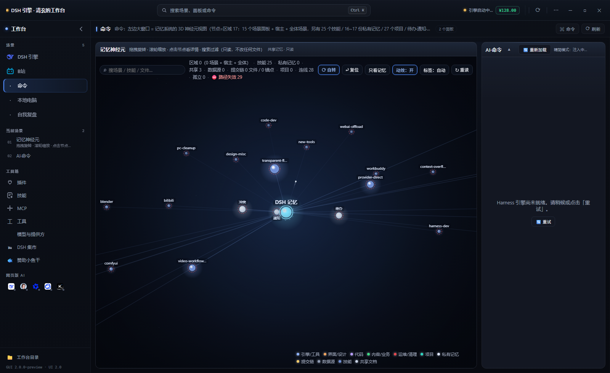
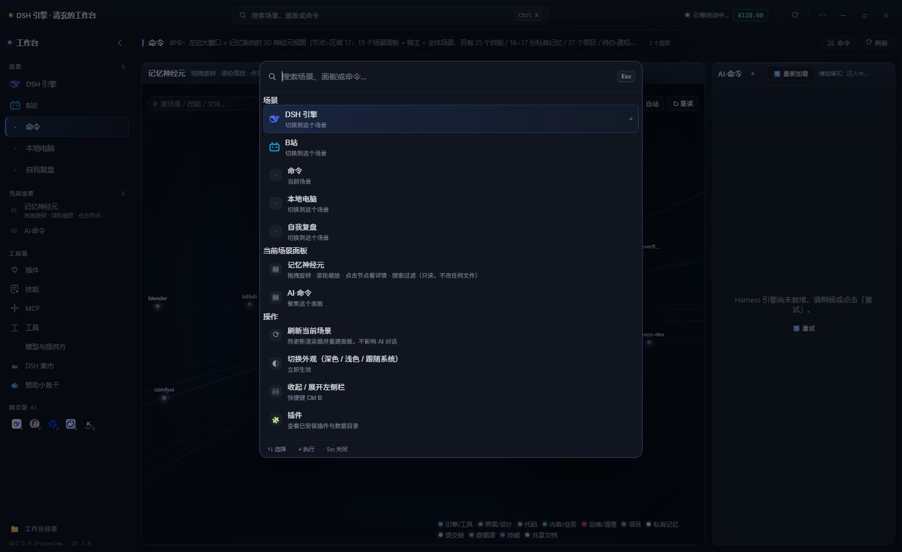
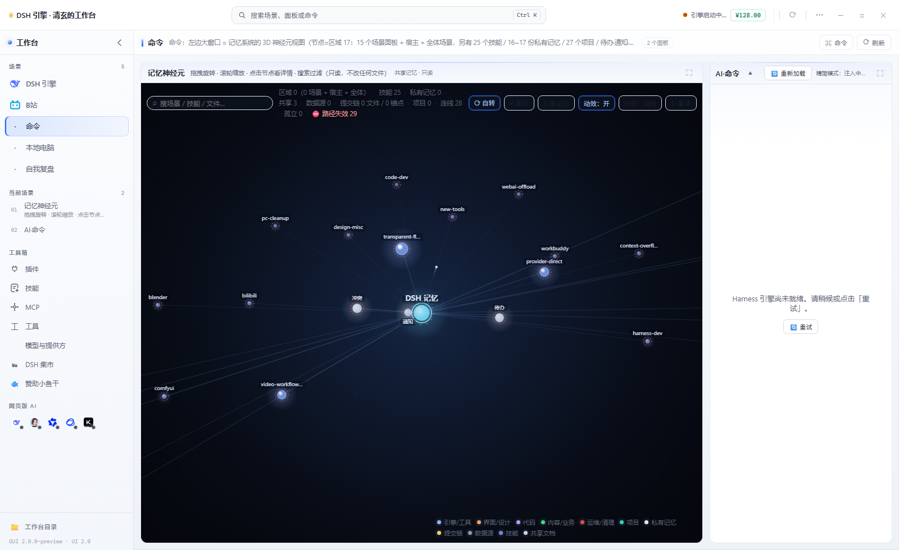

# 架构分析与 UI 重构 · 2026-11-03

> 范围：`12-源码照搬/外壳`（Electron 壳 + 渲染层）与 `scenarios/*.json`。
> 本文只谈**结构与可验证的做法**；不含任何会话 id、密钥、客户数据。
> 配套：`外壳/scripts/ui-check.mjs`（UI 自检）、`外壳/scripts/ui-preview.cjs`（不连引擎的预览/截图器）。
>
> 预览图（用真 `index.html` + 真 `renderers.js`，Chrome headless 截图）：
>  ·  · 

---

## 一、先说结论

当前工作台不是“一个页面”，而是**四套东西叠在同一棵 DOM 上**：

1. 引擎 webview（DSH Harness 本体）；
2. 本地场景网格（`scenarios/*.json` + `renderers.js` 的 10 种面板）；
3. 两层顶栏（38px 标题栏 + 52px 场景栏）与 14+ 个图标按钮；
4. 5 个顶栏状态胶囊（快照 / 待办 / 压力 / 更多 / 手机），后加的。

功能能跑，但**界面层没有边界**：`renderers.js` 清理前 18,817 行、1.1 MB、240 个顶层全局；`styles.css` 4,957 行、3 个 `:root`、105 个 `!important`；`main.js` 5,130 行 / 172 个 IPC handler。任何一次改动都要在“全局作用域 + 同名覆盖 + 热更新约束”里找位置。

本次做的是**一次可控的解构**：把界面壳层从 `renderer.js` / `renderers.js` 里抽出来，建立 `renderer/ui/` 模块层；用“投影旧 DOM”的方式重建布局，业务逻辑零改写；同时加命令面板、面板聚焦、场景/面板导航、快捷键与 UI 自检。**旧界面可一键回退**。

---

## 二、量化体检（2026-11-03 实测）

| 文件 | 行数 | 字节 | 说明 |
|---|---:|---:|---|
| `外壳/main.js` | 4,912 | 270,007 | 抽离 `main/scenes.js` 与 `main/inventory.js` 前 5,130 / 279,250；其余仍是窗口 / 引擎 / 远程访问 / 更新 |
| `外壳/preload.js` | 396 | 23,837 | 暴露 183 条 IPC 通道 |
| `外壳/renderer/renderer.js` | 1,355 | 75,653 | 场景切换 / 标题栏 / 弹窗 / 启动页 |
| `外壳/renderer/renderers.js` | 9,024 | 579,994 | 清理前 18,817 行 / 1.1 MB / 36 种；清理后 10 种（9 个场景类型 + `view` 复用） |
| `外壳/renderer/styles.css` | 4,957 | 294,125 | 3 个 `:root`、105 个 `!important`、多轮“末尾覆盖”叠加 |
| `外壳/renderer/topbar-status.js` | 1,733 | 100,732 | 顶栏状态区，独立全局 IIFE |
| `外壳/renderer/webai-bridge.js` | 1,515 | 130,044 | 网页版 AI 桥 |

**面板类型覆盖率**

- `renderers.js` **清理前**注册 36 种面板类型，公开 4 场景只用到 9 种；
- 2026-11-04 第一刀已把无引用/无交叉引用的 24 个渲染器块、`flow` / `file` 两个大块和 50 个孤儿函数删掉：
  **1,102,826 B → 579,994 B（-47%）**，18,817 → 9,024 行（-52%），36 → 10 种；
- 剩下 10 种里 9 种被场景直接使用，`view` 被 `review-doc` 复用（不能按“场景没引用”删）；
- 四场景运行时审计（真 `index.html` + 真 `renderers.js`）无 `面板渲染失败` / `未知面板类型`。

**界面动作密度**

- 标题栏 38px + 场景栏 52px = 90px 常驻 chrome；
- 标题栏右侧 14+ 个可点击控件，其中 6 个是低频工具（插件 / 技能 / 工具 / 模型 / 集市 / 赞助）；
- 场景栏右侧 5 个状态胶囊 + 余额 + 连接状态；
- 没有全局搜索 / 命令入口；面板只能“看”，不能“跳转/聚焦”。

**耦合**

- `preload` 183 条通道 ↔ `main` 172 个 handler；
- 公开模板仍保留 OA / 股票 / Blender / 个人站 / 视频工作流等已下线场景的 IPC 与渲染器；
- 渲染层通过 `window.app.oa / stock / blender / site / review / pc` 直接触达多个业务域，没有“场景能力”边界。

---

## 三、结构性问题（按影响排序）

### 1. `renderers.js` 是“场景渲染器 + 工具库 + 主题 + 标签栏交互”的混合体

- 顶层 240 个 `var/function`，全部挂在全局；
- 热更新要求所有顶层声明用 `var`（`const/let` 重复加载会报错），进一步放大了全局污染；
- 任何场景的渲染器都可以调用任何工具函数，删除一个“死场景”前无法用静态依赖判断安全性。

**后果**：新增面板只能往同一个文件追加；文件越大，热更新越慢，冲突越难查。

### 2. 公开模板背着 75% 的死渲染器

清理前 36 种类型里 27 种没有场景引用。它们不是“注释”，而是会被 Chrome 解析、被 `check-gui` 扫描、被热更新重新加载的真实代码。公开模板的维护者需要为不再存在的客户场景持续付出认知成本。第一刀已删掉 24 个无引用块 + `flow` / `file` 两个大块。

### 3. 顶栏信息架构过载

工具入口、窗口动作、状态、场景切换全部挤在两条 90px 的横条里：

- 图标含义靠 title 提示，新用户无法发现；
- 低频动作（集市 / 赞助 / 技能 / 工具）和高频动作（刷新 / 主题 / 窗口）同权重；
- 场景栏与标题栏职责重叠（都像“全局栏”），页面没有“当前场景”的清晰语境；
- 5 个状态胶囊是后加的，没有统一收纳。

### 4. 面板是“死网格”，没有导航层

`scenarios/*.json` 用 `col/row/w/h` 固定排版，渲染后就是一堆 `.panel`：

- 面板多了只能靠滚动/记忆找；
- 只有 AI 面板有 `▲ 展开`，普通面板没有聚焦；
- 没有“当前场景有哪些面板”的目录，也没有键盘跳转。

### 5. CSS 是“追加式历史”

`styles.css` 末尾至少叠了三轮“精致化 / 玻璃感 / 省电”覆盖层，同名选择器互相打架：

- 3 个 `:root` 定义同一批令牌；
- 105 个 `!important`；
- 想改一个圆角，需要先判断哪一层最后生效。

### 6. 缺少 UI 级回归

`check-gui.mjs` 覆盖语法 / IPC / 面板类型 / 定时器 cleanup / 目录契约，但**不检查 DOM 结构**：删一个挂载点、改错脚本顺序、CSS 括号失衡，都可能到“打开白屏”才被发现。

---

## 四、目标架构（界面层）

```text
L0 主进程 main.js
   窗口生命周期 / 引擎进程 / 安全边界 / 系统能力
        │ IPC（preload 契约）
L1 preload.js
   window.app.<域>.<方法>  ← 唯一的宿主能力面
        │
L2 renderer/core  ← 本次新增
   WB.bus / WB.store / WB.dom / WB.util / WB.flags
        │
L3 renderer/ui    ← 本次新增
   shell（顶栏 / 左栏 / 语境栏 / 更多菜单）
   command（命令面板）
   panels（面板聚焦 / 面板级动作）
        │ 只读 DOM + 调用现有按钮
L4 renderer/renderers.js
   面板渲染器（下一步按场景拆分）
        │
L5 scenarios/*.json
   场景配置（下一步加 schemaVersion / 面板注册表）
```

**四条边界规则**

1. **壳层不拥有业务状态**：场景切换仍点 `#scenario-tabs` 的原生 `.tab`，工具仍点原 `#btn-*`，AI 仍由 `renderers.js` 渲染。
2. **UI 模块不直接碰 IPC**：只通过现有按钮/`window.app` 的既有入口，避免把 183 条通道再扩散一遍。
3. **新增文件必须可独立回退**：`ui/*` 只在 `body.wb-v2` 下生效；删掉 `<link>`/`<script>` 即回经典。
4. **体量红线**：新增 UI 文件 ≤ 800 行；`ui-check` 强制检查。

---

## 五、本次落地：UI 2.0

### 5.1 布局：从“两条横栏”到“一横一竖”

```text
旧：
┌ 标题栏（品牌 + 14 个图标 + 窗口键） ────────────────┐ 38px
├ 场景栏（工作台 | 标签… | 余额/状态） ───────────────┤ 52px
└ 内容（webview 或 #grid） ───────────────────────────┘

新：
┌ 顶栏（品牌 | 全局搜索 Ctrl K | 引擎状态/余额 | 更多 | 窗口键） ┐ 54px
├ 左栏（场景 / 当前场景面板 / 工具箱 / 工作台目录） ┬ 语境栏（场景名·说明·面板数·命令·刷新） ┤ 44px
│                                                  └ 工作区（#grid / webview）              │
└──────────────────────────────────────────────────┴──────────────────────────────────────────┘
```

- 左栏 238px，可收起为 64px（`Ctrl B`，状态记在 `wb.ui.rail.collapsed`）；
- 低频工具从顶栏搬到左栏“工具箱”，**节点移动而非重建**，原有事件监听全部保留；
  - 插件 / 技能 / MCP / 工具原本被 `renderers.js` 收进 `#tb-group-ext` 并会被它的 MutationObserver 反复拉回顶栏：这里把**整组**收进隐藏容器，左栏只摆“代理行”，点击转给原按钮，互不打架；
  - 网页版 AI 的 5 个图标（`#webai-strip`）从品牌旁边搬到左栏“网页版 AI”区，热更新后若被重建会自动再搬回；
- 引擎状态点 / 状态文字 / 余额从场景栏搬到顶栏；
- 场景栏只保留“当前场景语境 + 命令/刷新”，成为真正的 context bar。

### 5.2 新增能力

| 能力 | 入口 | 说明 |
|---|---|---|
| 命令面板 | `Ctrl/⌘ K` 或顶栏搜索框 | 模糊搜索场景 / 面板 / 操作；↑↓ 选择，↵ 执行，Esc 关闭 |
| 场景导航 | 左栏「场景」 | 从 `#scenario-tabs` 投影；显示 AI 工作光点、独立窗口按钮 |
| 面板导航 | 左栏「当前场景」 | 列出 `#grid > .panel`；单击滚动+高亮，双击/⛶ 聚焦 |
| 面板聚焦 | 每个面板标题右侧 `⛶` 或 `Ctrl Shift F` | 原位占位 + `position:fixed` 撑满工作区；Esc / 点遮罩退出 |
| 更多菜单 | 顶栏 `⋯` | 切换经典界面、收起左栏、快捷键、打开工作台目录/场景记忆/场景配置 |
| 快捷键说明 | `⋯ → 键盘快捷键` | 常驻可查 |
| 场景快捷键 | `Alt 1…9` | 按标签顺序切换 |
| UI 回退 | `⋯ → 切换 2.0 / 经典界面` 或 `?ui=classic` | 经典模式顶栏留了「2.0」按钮，可一键切回；也支持 `?ui=v2` |

### 5.3 关键实现选择（为什么不是重写）

- **投影而非分叉**：`#scenario-tabs` 保留为场景状态的唯一真源，只是视觉移出屏幕；左栏是它的投影。这样永远不存在“两套 active 状态”。
- **移动 / 代理而非重绑**：模型 / 集市 / 赞助直接移动节点；被 `renderers.js` 反复重排的「扩展组」收进隐藏容器，左栏代理行点击原按钮，事件监听都在原节点上。
- **只读面板 DOM**：聚焦按钮注入 `.panel-head`，不改 `makePanel` 的布局逻辑；与旧 `▲ 展开` 互斥，先收起旧展开态。
- **不碰 AI webview**：`#harness-view` 结构不变，webview 分区/注入/绑定逻辑完全不动。

### 5.4 文件清单

| 文件 | 行数 | 职责 |
|---|---:|---|
| `renderer/ui/preload-ui.js` | 27 | 读取 `?ui=` / `?solo=` / localStorage，决定 classic / v2 / 分离窗口 |
| `renderer/ui/ui-core.js` | 152 | `WB.bus / store / dom / util / flags / ready` |
| `renderer/ui/ui-panels.js` | 184 | 面板聚焦 + 聚焦按钮注入 + Esc/遮罩 |
| `renderer/ui/ui-command.js` | 334 | 命令面板（场景/面板/操作/打开目录） |
| `renderer/ui/ui-shell.js` | 669 | 顶栏 / 左栏 / 语境栏 / 更多菜单 / 快捷键 / 观察器 |
| `renderer/ui/ui.css` | 637 | 全部 UI 2.0 样式（作用域 `body.wb-v2`） |
| `scripts/ui-check.mjs` | 124 | 语法 / 顺序 / id / 挂载点 / CSS 花括号 / 体量自检 |
| `scripts/ui-preview.cjs` | 55 | 不连引擎的预览/截图器（生产环境可选） |
| `scripts/renderer-audit.mjs` | 89 | 只读审计：类型覆盖 / 死候选 / 孤儿函数 / 体量 |
| `main/scenes.js` | 114 | 场景配置 / 实例叠加 / 标签顺序（主进程第一块外置模块） |
| `scripts/scenes-store.test.mjs` | 59 | 场景模块 smoke test（4 组，临时目录写 order） |
| `main/inventory.js` | 231 | 只读清点：版本 / 插件 / 技能 / 工具清单 / 设置与密钥脱敏 |
| `scripts/inventory.test.mjs` | 87 | 清点模块 smoke test（6 组，测试密钥脱敏与配置解析） |

`renderer.js` **零改动**：壳层不向业务代码要事件，而是用 `MutationObserver` 观察
`#scenario-tabs`（标签增删 / active 类）、`#grid`（面板重建）、`#scenario-view / #harness-view`（视图切换）。
`index.html` 只加了 1 个 preload 脚本、1 个样式、4 个模块脚本。
`renderers.js` 只做**死代码清理**（公共 9 种渲染器的行为未改），并新增只读 `renderer-audit.mjs` 供复查。

---

## 六、验证

```powershell
cd 12-源码照搬\外壳
node scripts/ui-check.mjs        # 本次新增：UI 壳层自检
node scripts/check-gui.mjs       # 原有：语法 / IPC / 面板类型 / 目录契约
node scripts/sessions.mjs --check
node ..\工具\体检.mjs
```

本次实测（2026-11-04，Windows / Node 24）：

- `ui-check.mjs`：**全部通过**（5 个模块语法、加载顺序、41 个 id 唯一、挂载点齐全、静态 id 引用存在、CSS 平衡、体量红线）；
- `check-gui.mjs`：**全部通过 ✓（warning 0）**——JS 语法 / IPC 对齐 / 场景面板类型 / 定时器 cleanup / 场景图标 / 场景隔离 / 稳定性护栏 / 启动依赖 / 注入脚本 / 会话对照 / 目录契约 / 引擎接线；
- `renderer-audit.mjs`：10 种注册类型、9 种场景使用、1 种复用、0 个孤儿函数；`renderers.js` 579,994 B / 9,024 行；
- `scenes-store.test.mjs`：**4 组全过**（列表 / 单场景 / 顺序 / 坏文件），主进程场景模块行为与抽离前一致；
- `inventory.test.mjs`：**6 组全过**（版本 / 工具清单 / 配置脱敏 / frontmatter / 降级 / 真实清单）；
- 四场景 runtime 审计：`#grid` 面板数 2 / 2 / 5 / 4，0 条 `面板渲染失败`、0 条 `未知面板类型`、0 page error；
- `工具\编码检查.mjs`：249 个文本文件，0 乱码 / 0 换行问题；
- `工具\体检.mjs`：**15 条断言 · 15 绿 · 0 红**；
- `工具\验收.mjs`：**6 步全绿**（编码 → 体检自检 → 身份索引 → 发布前检查 → 场景校验 → 代码红线）；
- `ui-preview.cjs` / Chrome headless（真 `index.html` + 真 `renderers.js` + 内存桩宿主）：产出 1600×980 / 1000×660 两档截图，验证了默认布局、命令面板、左栏收起/展开、面板聚焦、浅色主题、经典回退六种状态；
  - 预览图：[默认布局](UI-2.0-预览.png)、[命令面板](UI-2.0-命令面板.png)、[浅色主题](UI-2.0-浅色.png)。

---

## 七、下一步路线（按收益排序）

### P0 · 已完成（本次）

- [x] 抽出 `renderer/ui/` 模块层与 `WB` 命名空间
- [x] 顶栏 / 左栏 / 语境栏 / 工作区四区布局
- [x] 命令面板、面板聚焦、场景/面板导航、快捷键、UI 回退
- [x] `ui-check.mjs` + `ui-preview.cjs`

### P1 · 拆分 `renderers.js`（第一刀已完成）

**已完成（2026-11-04）**：

- 删除 24 个单引用渲染器块、`flow` / `file` 两个大块、50 个孤儿函数；
- **1,102,826 B → 579,994 B（-47%）**，18,817 → 9,024 行（-52%），36 → 10 种；
- 新增 `scripts/renderer-audit.mjs`（只读审计：类型覆盖 / 死候选 / 孤儿函数 / 体量），`npm run audit:renderers` 可重复跑；
- 四场景 runtime 审计全部无 `面板渲染失败` / `未知面板类型`；`check-gui` / `验收` / `代码红线` 全绿。

**下一刀（目标 ≤300 KB）**：

1. 建 `renderer/renderers/` 目录，按场景拆：`neuron.js`、`review.js`、`pc.js`、`embed.js`、`harness.js`；
2. 抽 `renderer/renderers/_shared.js`（`el / panelHead / makePanel / cleanup 注册`）；
3. 保留 `renderers.js` 作为兼容入口：按 `scenario.panels[].type` 懒加载对应文件（或启动时一次性加载）；
4. 清理剩余 `FLOW_*` 常量、OA/site/stock 死注释与空函数；
5. 验收：`check-gui` 面板类型覆盖仍全绿；首屏 `renderers.js` 网络传输 < 300 KB；冷启动到可点击 < 2s。

### P1 · 拆 `main.js`

**已完成（2026-11-04 · 累计从 5,130 行减至 4,912 行，单次已拆 2 块）**：

1. **场景存储**：`main/scenes.js`（114 行）承接 `readManifest / listScenarios / getScenario / readSceneTabOrder / saveSceneTabOrder`；配套 `scripts/scenes-store.test.mjs`（4 组全过）；
2. **只读清点**：`main/inventory.js`（231 行）承接 `versionInfo / listPlugins / listSkills / readToolCatalog / readSettings` 及 frontmatter 解析；配套 `scripts/inventory.test.mjs`（6 组全过）；
3. `main.js` 进入 5,000 行以内（5,130 → 4,912 行）；`check-gui` 契约放行 `main/`，`backup-gui.mjs` 快照覆盖。

**下一块**：

- 目标：单文件 ≤ 800 行；
- 建议边界：`main/window.js`（窗口/多窗口/恢复）、`main/engine.js`（引擎进程/端口/启动）、`main/media.js`（Blender/Office/预览）、`main/update.js`（updater/版本策略）；
- 做法：继续按域拆分无环依赖的独立模块，每步跑 `test:scenes` + `test:inventory` + `check-gui` + `验收`。

### P2 · 收敛 CSS

- 合并 3 个 `:root` 到 `styles/tokens.css`；
- 按层拆 `base / chrome / panel / scene / modal`；
- 目标：`!important` 105 → ≤ 20；同名覆盖层 ≤ 1 层；
- 验收：`ui-check` 增加“禁止新增 `!important`”规则（存量白名单）。

### P2 · 场景配置契约

- `scenarios/*.json` 增加 `schemaVersion`；
- 校验：panel type 必须在注册表、`col/w` 不越界、`sessionTitle` 与 `pinTarget` 一致；
- 把 `check-gui` 的第 3 节升级为 schema 校验。

### P2 · UI 回归

- 把 `ui-check.mjs` 接进 `验收.mjs`；
- 用 `ui-preview.cjs --shot` 在 CI/本地生成 4 张固定截图（默认 / 命令面板 / 收起 / 聚焦），做像素基线；
- 新增“删挂载点必须红”的反例自检（`ui-check --self-test`）。

---

## 八、风险与回退

| 风险 | 现状 | 回退 |
|---|---|---|
| UI 2.0 影响旧交互 | 业务零改写；只移动节点/投影标签 | `⋯ → 切换经典界面` 或 `?ui=classic` |
| 场景标签拖拽换位 | 2.0 中标签栏视觉移出，拖拽换位暂不可用（排序仍由主进程 `scene-tab-order.json` 决定） | 切回经典界面即可拖；后续在左栏补拖拽 |
| 左栏占宽 | 可 `Ctrl B` 收起为 64px，状态持久化 | 同上 |
| 面板聚焦与旧 `▲ 展开` 冲突 | 聚焦前先 `collapsePanel` | 关闭聚焦即恢复 |
| UI 模块文件损坏 | `ui-check` 在启动前可查；CSP 只允许本地脚本 | 删除 `ui/*` 的 script/link 即回经典 |

---

## 九、一句话

**把“界面壳层”从业务代码里拿出来，让界面可以独立演进、独立验证、独立回退；下一步再把 580 KB 的渲染器拆成按场景模块、把 5 千行的主进程按域拆开。**
